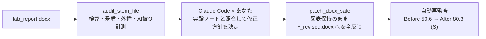

<div align="center">

# STEM Report Auditor

**理系レポートの「検算・矛盾・系統誤差外挿・脱量産型AI考察」を1コマンド＆MCPで自動監査する数理Linter**

[](https://www.python.org/)
[](requirements.txt)
[](uniqueness_scorer/mcp_server.py)
[](LICENSE)

*Don't ask an LLM to "vibe-check" your lab report. Give it a deterministic compiler.*

</div>

---

> **無料・ローカルで動きます。** APIキーもアカウントも不要で、レポートはあなたのパソコンの外に送信されません。Python を入れて「起動.bat」をダブルクリックすれば、ブラウザで使えるアプリが開きます（[アプリで使う](#アプリで使うダブルクリックで起動)）。OpenAI / Gemini は、独自性診断の比較用回答を自動で作りたいときだけの任意機能です。

---

## What It Catches in 1 Second

Word（`.docx`）を1ファイルそのまま投げると、**暗算ミスゼロの決定論的監査**と**データに埋もれた加点ポイント**を即座に返します。

```text
$ python cli.py audit lab_report.docx --html-out audit.html

総合監査スコア : 50.6 / 100  [B]  (決定論的品質 58.0 | 理系考察 44.6)

  [PASS    ] 表1  2θ → sin²θ 三角関数検算：全4行一致
  [PASS    ] 表2  格子定数 a = d√(h²+k²+l²)：全4行一致
  [CRITICAL] 本文 ミラー指数 (100) が表 [(110),(200),(211),(220)] と不一致（BCC消滅則違反）
  [CRITICAL] 誤記 「解説が起こる」→「回折」の変換ミス
  [WARNING ] 表1  同一列の有効数字が不統一 (1 vs 1.998, 2.991, 3.980)
  [WARNING ] 解析 全4点が負側バイアス → 読み取り誤差（ランダム）のみでは物理的に矛盾
  [INFO    ] 発見 cos²θ と強い線形相関 (r=-0.990, R²=0.980)
                  → x→0 外挿で a = 0.28647 nm（単純平均の誤差を 81.5% 削減）
```

> 監査結果・回帰外挿グラフ・主張単位のAI被りヒートマップは、そのままブラウザで開けるスタンドアロンHTMLにも出力できます。

### どんな実験の表でも：汎用検算

```text
$ python cli.py table ohm.csv

推定した計算関係:
  P (mW) = V·I   [4/5 行一致]
指摘 1 件:
  [CRITICAL] 行4 P (mW): 他の4行は「P = V·I」で一致しますが、この行は記載 136 に対し計算値 163.2（許容 ±0.74）です。
```

列名や実験テーマに頼らず、数値だけから列どうしの式（四則演算・定数倍・単位換算・平方/平方根/対数/三角関数・`t + 273.15`・平均/合計/標準偏差・`ab/(a+b)`・文献値に対する誤差率）を推定し、各セルの丸め幅を伝播させた許容範囲で照合します。`audit` では Word/PDF 内のすべての表に自動で適用されます。

- 見つけるもの：式から外れた行、平均・標準偏差の行の誤り（n と n−1 の区別）、手計算の表での最終桁のずれ、単位換算の桁ずれ、度/ラジアンの取り違え、2θ をそのまま使った三角関数
- できないこと：列全体が同じ誤った式（上記の角度・単位以外）、3列以上をまたぐ式、表にない定数が2つ以上入る式
- 精度と有料LLMとの比較：[validation/TABLE_BENCH_REPORT.md](validation/TABLE_BENCH_REPORT.md)（表の算術だけなら、丁寧に検算させたLLMとほぼ同等。差は再現性・コスト・規模に出ます）

---

## Why Not Just Ask ChatGPT / Claude?

| チェック項目 | 素のLLMに「採点して」 | **STEM Report Auditor (+ MCP)** |
| :--- | :--- | :--- |
| 表の全行検算・表間の数値突合 | 雰囲気読み・暗算ミスが起きる | **NumPyで全行100%決定論的検算** |
| どんな実験の表でも検算 | 毎回結果が揺れる・長い表で見落とす | **列間の式を自動推定し、丸め幅から許容誤差を決めて照合**（合成表の最終評価で検出 91.5%・誤検知 0%） |
| 系統バイアス検知・線形外挿 | 自分から最小二乗法を回さない | **相関 $R^2$・外挿値・誤差削減率を自動算出** |
| 「概ね一致・読み取り誤差」の量産考察 | LLM自身の好みに近く**高評価してしまう** | **逃げ表現減点＋Vendi Score増分で厳格採点** |
| Word（`.docx`）の安全修正 | バイナリ直接編集が苦手 | **元ファイル非上書き・図表保持のままコピー修正** |

---

## Works Natively with Claude Code (MCP)

素のLLMの代わりではなく、**Claude Code に持たせる「Linter＋自動検算機」**として動きます。



### Claude Code 登録（1行）

```bash
claude mcp add -s user uniqueness-scorer -- python "/path/to/repo/cli.py" mcp
```

登録後、Claude Code にそのまま話しかけるだけです：

> `report.docx` を `audit_stem_file` で監査して。見つかったミスと考察の改善案を私に確認しながら、OKを出した箇所だけ `patch_docx_safe` でコピー版へ反映して再監査して。

---

## アプリで使う（ダブルクリックで起動）

コマンドを打たなくても使えます。

1. [python.org](https://www.python.org/downloads/) から Python 3.10 以上をインストールします（Windows はインストール画面で「Add python.exe to PATH」にチェック）。
2. このリポジトリを [ZIP でダウンロード](https://github.com/yangjitian285-lgtm/stem-report-auditor/archive/refs/heads/main.zip)して展開します。
3. **Windows は `起動.bat`、Mac は `start.command` をダブルクリック**します。初回だけ必要な部品（NumPy など）を自動でインストールし、ブラウザで画面が開きます。

| タブ | できること |
| :--- | :--- |
| レポートを監査 | Word / PDF をドラッグ＆ドロップ。表の検算・表と本文の矛盾・有効数字・誤記・未回答を調べ、直す順のリストとグラフ付きの詳細レポートを表示 |
| 表を検算 | Excel や Word の表をコピーして貼るだけ。数値から式を推定し、合わないセルを赤く表示 |
| 独自性を診断 | 課題文・原稿・比較用のAI回答（3つ以上）を貼ると、文ごとの被り具合を表示 |

- 動作はすべてローカルです。アプリは `127.0.0.1`（このパソコンの中）でだけ待ち受け、アップロードしたファイルは処理後に一時フォルダごと消します。
- 終了するには、起動時に開いた黒いウィンドウを閉じます。
- `python app.py` でも起動できます（`--port 9000` でポート変更）。

---

## Quickstart (30 Seconds)

```bash
git clone https://github.com/yangjitian285-lgtm/stem-report-auditor.git
cd stem-report-auditor
pip install -r requirements.txt
```

```bash
# 1. 合成データでデモを実行（APIキー不要）
python demo_stem.py

# 2. 自分のWordレポートを1コマンド完全監査＋HTML出力
python cli.py audit your_report.docx --html-out audit.html

# 2'. CSV / TSV / Markdown の表だけを汎用検算（1行目が見出し）
python cli.py table your_table.csv

# 3. 論述レポート・就活ESの「脱・量産型AI」採点
python cli.py score --task task.txt --draft draft.md --cohort cohort.json --html-out report.html
```

> ここまでの機能はすべて**無料・オフライン**で動きます（`--provider local` が既定。APIキーは不要）。
>
> **PDF直接監査**を使いたい場合のみ `pip install pypdf` を追加してください。OpenAI / Gemini API を使う場合は `--provider openai` または `--provider gemini` を指定すると、仮想・量産型AI母集団の生成まで全自動化されます。

---

## Details

<details>
<summary><strong>MCP Tools一覧（全7ツール）</strong></summary>

| Tool | Description |
| :--- | :--- |
| `audit_stem_file` | `.docx` / `.pdf` / `.txt` を1ファイル丸投げ完全監査（検算・表間矛盾・有効数字・誤記・系統バイアス外挿・考察6軸） |
| `check_table_generic` | 分野を問わない汎用表検算（CSV/TSV/Markdown テキスト、または headers+rows）。推定した式（relations）と外れた行を返す |
| `patch_docx_safe` | 元 `.docx` 保護・図表/書式保持で `*_revised.docx` へパッチ適用＋Before/After自動再監査 |
| `score_stem_report` | 理系考察テキスト＋実測データ系列の6軸数理診断 |
| `score_report_uniqueness` | 自由論述レポート・就活ESの6軸独自性スコア＋品質ゲート |
| `diagnose_claims_heatmap` | 主張（文）単位の量産型AI被り率（RED / YELLOW / GREEN）抽出 |
| `compare_draft_revisions` | 改訂前後のスコア・$\Delta\text{VS}$・主張被り率の定量比較 |

</details>

<details>
<summary><strong>数理モデル仕様（Vendi Score・LOOマハラノビス・品質ゲート）</strong></summary>

#### 1. 自由論述・就活ESモード（`math_engine.py`）
仮想・量産型AI母集団 $\mathcal{R}(q)=\{y_1,\dots,y_M\}$ に対する統合独自性スコア：

$$\text{Score}(x \mid q) = 100 \times G(x \mid q)^{\alpha} \times \Bigl(w_1 S_{\text{vendi}} + w_2 S_{\text{maha}} + w_3 S_{\text{knn}} + w_4 S_{\text{claim}} + w_5 S_{\text{skeleton}} + w_6 S_{\text{spec}}\Bigr)$$

- **限界Vendi Score増分**：$\Delta \text{VS}(x \mid \mathcal{R}) = \text{VS}(\mathcal{R} \cup \{x\}) - \text{VS}(\mathcal{R})$（Friedman & Dieng, TMLR 2023）
- **LOO正則化マハラノビス距離**：Ledoit-Wolf型収縮＋Woodbury恒等式による高次元・小標本厳密校正
- **品質ゲート $G(x \mid q)$**：課題から逸脱した珍文による距離ハックを遮断

#### 2. 理系計算・実験モード（`stem_engine.py` / `stem_auditor.py`）
1. 脱・量産型AI考察（主張単位被り率＋$\Delta\text{VS}$）
2. 脱・理系逃げフレーズ（未定量の「読み取り誤差・環境要因・概ね一致・測定回数増加」）
3. 誤差方向（バイアス符号）＆系統トレンド整合（片側バイアス×ランダム誤差の物理矛盾検知）
4. オーダー評価・誤差伝播の定量性
5. 物理メカニズム・理論近似破綻の深掘り
6. 結果再述からの脱却度

</details>

<details>
<summary><strong>テスト実行（pytest）</strong></summary>

```bash
pip install -r requirements-dev.txt
python -m pytest -q
python validation/table_bench.py --split holdout   # 汎用表検算のベンチマーク
```

</details>

---

## License

[MIT](LICENSE)
